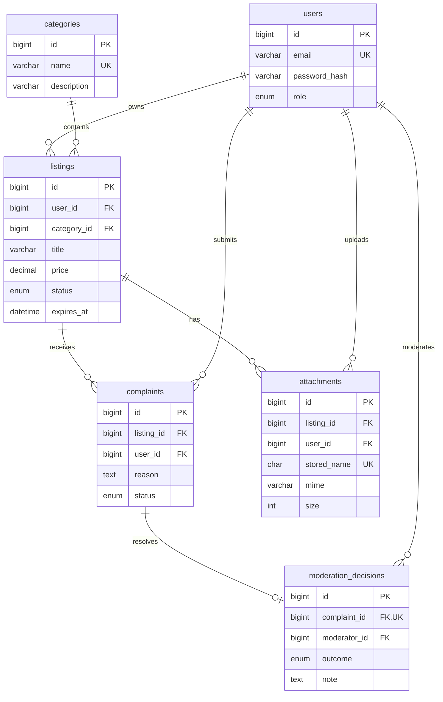

# Ma’lumotlar modeli va lug‘ati

Quyidagi model `database/schema.sql` dagi tuzilma asosida yozilgan. Barcha jadvallar InnoDB; ulanish va baza utf8mb4 bo‘lishi kerak. `id` ustunlari BIGINT UNSIGNED AUTO_INCREMENT birlamchi kalit. Bu hujjat bazaning import qilingani yoki cheklovlar amalda tekshirilganini isbotlamaydi; tegishli dalillar QA bayonnomasida bo‘ladi.

`contact_messages` va `auth_attempts` mustaqil yordamchi qaydlar; ular uchta predmet jadvali talabiga hisoblanmaydi. Asosiy predmet zanjiri categories → listings → complaints → moderation_decisions.

## Ma’lumotlar lug‘ati

Barcha quyidagi ustunlar NOT NULL. PK va AUTO_INCREMENT ko‘rsatilgan umumiy `id` ustuni har jadvalda mavjud.

| Jadval | Ustunlar: tur va vazifa | Cheklov va indeks |
|---|---|---|
| users | name VARCHAR(80); email VARCHAR(190); password_hash VARCHAR(255); role ENUM(admin,moderator,user), default user; created_at DATETIME default CURRENT_TIMESTAMP | email UNIQUE; parol ochiq matnda saqlanmaydi |
| categories | name VARCHAR(80); description VARCHAR(500); created_at DATETIME default CURRENT_TIMESTAMP | name UNIQUE |
| listings | user_id, category_id BIGINT UNSIGNED; title VARCHAR(120); description TEXT; city VARCHAR(80); price DECIMAL(14,2), default 0; phone VARCHAR(25); status ENUM(active,expired,blocked,archived), default active; expires_at DATETIME; created_at DATETIME; updated_at DATETIME | FK user/category ON DELETE RESTRICT; CHECK(price>=0); listing_filter(category_id,city,status,expires_at); listing_owner(user_id); updated_at avtomatik yangilanadi |
| complaints | listing_id, user_id BIGINT UNSIGNED; reason TEXT; status ENUM(open,approved,rejected), default open; created_at DATETIME | FK listing/user RESTRICT; UNIQUE(user_id,listing_id) — foydalanuvchining bir e’longa bitta shikoyati; INDEX(status) |
| moderation_decisions | complaint_id, moderator_id BIGINT UNSIGNED; outcome ENUM(approved,rejected); note TEXT; created_at DATETIME | complaint_id UNIQUE — bitta shikoyatga bitta yakuniy qaror; FK complaint/user RESTRICT |
| attachments | listing_id,user_id BIGINT UNSIGNED; original_name VARCHAR(200); stored_name CHAR(64); mime VARCHAR(80); size INT UNSIGNED; description VARCHAR(500); created_at DATETIME | stored_name UNIQUE; FK listing/user RESTRICT; INDEX(listing_id) |
| contact_messages | name VARCHAR(80); email VARCHAR(190); message TEXT; smtp_status ENUM(pending,sent,failed), default pending; ip_hash CHAR(64); created_at DATETIME | INDEX(ip_hash,created_at); SMTP xatosida yozuv qoladi |
| auth_attempts | ip_hash CHAR(64); created_at DATETIME | INDEX(ip_hash,created_at); kirish tezligini nazorat qilish uchun |

## Saqlash va o‘chirish qarorlari

E’lon o‘chirish amali `archived` holatiga o‘tkazadi. Bu shikoyat va moderator qarori tarixini saqlash uchun tanlangan arxivlashdir. Arxivlangan yozuv faol katalogdan chiqadi. Toifa bog‘langan e’lonlar mavjud bo‘lsa o‘chirilmaydi; foydalanuvchi avval bog‘liqlikni hal qilishi kerak. FK RESTRICT yetim yozuvni taqiqlaydi.

`moderation_decisions.complaint_id` UNIQUE cheklovi bir vaqtda kelgan takroriy qarorga baza darajasida ham to‘siq bo‘ladi. Model tranzaksiya va qator blokirovkasini qo‘llashi kerak; bu cheklovning o‘zi butun jarayon izchilligini almashtirmaydi.

`expires_at` server vaqti bilan talqin qilinadi. Muhit va ilovada vaqt zonasi bir xil sozlanishi kerak. Faol ro‘yxat status bilan birga muddatni ham tekshirishi lozim; faqat fon jarayoniga tayanilmaydi.

## Qayta tiklash uchun kerakli qismlar

SQL zaxira jadvallarni tiklaydi, ammo yuklangan fayllarning o‘rnini bosmaydi. To‘liq tiklashda baza zaxirasi va shu vaqtdagi `storage/uploads` nusxasi birgalikda saqlanadi. Baza paroli, sessiya va maxfiy sozlamalar topshirish arxiviga kiritilmaydi. Tiklash alohida sinov bazasida tekshiriladi; ishlab turgan bazani tekshirish uchun o‘chirish tavsiya etilmaydi.
