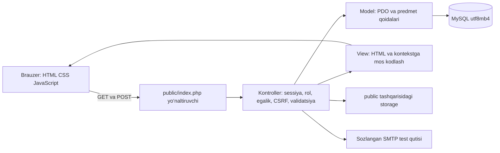

# 48-mavzu: texnik topshiriq

Loyiha: **Yaqin — elektron e’lonlar va xizmatlar katalogi**.

Asos: foydalanuvchi bergan “Web dasturlashga kirish” uslubiy ko‘rsatmasi, 5.1–5.11-bandlar (8–14-betlar), sinov va topshirish talablari (15–22-betlar), A ilova 48-mavzu (28-bet). Hujjatdagi boshqa mavzular ushbu loyiha doirasiga kirmaydi. Bu texnik topshiriqning o‘qituvchi tomonidan tasdiqlangani haqida dalil yo‘q.

## Muammo va maqsad

Tarqoq e’lonlarni toifalar bo‘yicha topish, e’lonning amal qilish muddatini boshqarish va shikoyatlarga asoslangan moderator qarorlarini izchil qayd etish zarur. Maqsad — ushbu amallarni foydalanuvchi vakolatlari bilan cheklangan, bazaga tayangan web-ilovada birlashtirish.

## To‘rtta mustaqil dinamik bo‘lim

| Bo‘lim | Mazmun va amal | Asosiy obyekt |
|---|---|---|
| E’lonlar | Qidirish, ikki filtr, saralash, sahifalash, tafsilot, yaratish/tahrirlash/arxivlash, muddat | listings |
| Toifalar | Ro‘yxat, tafsilot, yaratish/tahrirlash/o‘chirish; bog‘liq e’lon borligini tekshirish | categories |
| Shikoyatlar | E’longa sabab bilan shikoyat; o‘z murojaati holatini ko‘rish; moderator navbati | complaints |
| Tekshirish qarorlari | Shikoyatni qanoatlantirish yoki rad qilish, asos va qaror tarixini ko‘rsatish | moderation_decisions |

Bosh sahifa, kirish, aloqa va administrator kabineti ushbu to‘rt bo‘lim hisobiga kiritilmaydi. Filtrlangan bir ro‘yxat ham alohida bo‘lim hisoblanmaydi.

## Foydalanuvchilar va vakolatlar

| Amal | Mehmon | user | moderator | admin |
|---|---|---|---|---|
| Faol e’lonlar va toifalarni ko‘rish | Ha | Ha | Ha | Ha |
| E’lon yaratish | Yo‘q | Ha, o‘z nomidan | Ha | Ha |
| E’lonni tahrirlash, arxivlash, uzaytirish | Yo‘q | Faqat o‘ziniki | Faqat o‘ziniki | Ha |
| Toifa CRUD | Yo‘q | Yo‘q | Yo‘q | Ha |
| Shikoyat yuborish | Yo‘q | Ha | Ha | Ha |
| Shikoyat va qarorlarni ko‘rish | Yo‘q | O‘zi yuborgan yoki o‘z e’loniga oid | Moderatsiya navbati | Ha |
| Moderator qarori | Yo‘q | Yo‘q | Ha | Ha |
| Hisoblar va rollarni boshqarish | Yo‘q | Yo‘q | Yo‘q | Ha |
| Himoyalangan biriktirmani olish | Yo‘q | Yozuvga ruxsati bo‘lsa | Vakolati bo‘yicha | Vakolati bo‘yicha |
| CSV eksport | Yo‘q | Faqat ruxsatli ro‘yxat | Vakolati bo‘yicha | Vakolati bo‘yicha |

Mehmon tizimga kiradigan uch rol hisobiga kirmaydi. Jadval maqsadli kontrakt; yakuniy koddagi aniq ruxsatlar sinov bayonnomasida tekshirilishi kerak. Rolni tugma yashirish bilan emas, har bir server so‘rovida tekshirish shart.

## Arxitektura va ishonch chegaralari

Sof PHP ishlatiladi; PHP framework yoki tayyor CMS ishlatilmaydi. Model bazaga murojaat qiladi, kontroller so‘rov va vakolatlarni boshqaradi, View SQL bajarmaydi. JavaScript qulaylik beradi, lekin u o‘chirilganda ham server tekshiruvlari saqlanadi.

GET faqat o‘qish, qidiruv, tafsilot, forma va ruxsatli eksport uchun. Yaratish, tahrirlash, o‘chirish, uzaytirish, muddatni tugatish, shikoyat qarori va chiqish POST orqali bajariladi. Noma’lum marshrut 404; vakolatsiz kirish 403 yoki kirish sahifasiga yo‘naltirish; noto‘g‘ri qiymat tushunarli xabar; kutilmagan server xatosi maxfiy texnik tafsilotsiz javob beradi.

## Asosiy jarayon

1. Tizimga kirgan foydalanuvchi e’lonni yaratadi. Server toifa mavjudligi, sarlavha, tavsif, narx, telefon va amal qilish muddatini tekshiradi.
2. Ro‘yxatda faqat faol va muddati tugamagan e’lon ommaviy ko‘rinadi. Egasi o‘z yozuvining muddati tugaganini ham ko‘ra oladi.
3. Muddat tugashi yoki egasining tegishli amali e’lonni faol katalogdan chiqaradi.
4. Egasi ruxsat etilgan holatdagi e’lonni yangi kelajak muddatiga uzaytiradi. Moderator bloklagan yoki arxivlangan yozuv oddiy uzaytirish bilan qayta faollashmasligi kerak.
5. Foydalanuvchi e’longa sabab ko‘rsatib shikoyat yuboradi. Navbatdagi shikoyat holati ochiq bo‘ladi.
6. Moderator yoki administrator shikoyatni ko‘rib, asoslangan qaror kiritadi. Qanoatlantirish tegishli e’lonning ko‘rinishini cheklaydi; rad qilish uni bloklamaydi.
7. Qaror yaratish, shikoyat holatini yopish va kerak bo‘lsa e’lon holatini o‘zgartirish bitta tranzaksiyada bajariladi. Tekshiriladigan yozuvlar bloklanadi va bitta shikoyatga ikkinchi yakuniy qaror UNIQUE cheklovi bilan ham rad etiladi.

Statuslar: e’lon active/expired/blocked/archived; shikoyat open/approved/rejected. Uzaytirish +30 kun, hozirdan ko‘pi bilan 180 kun. Moderator o‘zi bergan yoki o‘z e’loniga oid shikoyatni ko‘ra oladi, lekin yakuniy qaror chiqara olmaydi. Ushbu hujjat qoidalar amalda tekshirilgani haqida sinov dalili emas.

## Xavfsizlik va nosozliklar

Parollar `password_hash` bilan saqlanadi va `password_verify` orqali tekshiriladi. Kirishda sessiya identifikatori yangilanadi, chiqishda sessiya tugatiladi. Cookie: HttpOnly, SameSite, HTTPSda Secure. Kirish va aloqa urinishlariga tezlik cheklovi qo‘llanadi.

Qiymatlar PDO parametrlariga bog‘lanadi; saralash ustuni ruxsat etilgan ro‘yxatdan tanlanadi. HTML matnlar kodlanadi. Barcha holat o‘zgartiruvchi so‘rovlarda CSRF tekshiriladi. Begona ID yuborish egalik tekshiruvini chetlab o‘tolmasligi shart.

Rasm 2 MB, PDF 5 MB, MP4 20 MB gacha. Kengaytma, server MIME turi va hajmi birga tekshiriladi; saqlash nomi tasodifiy. Fayllar bajarilmaydi, himoyalangan yuklab olishda yozuv vakolati tekshiriladi. Almashtirishda bazadagi yozuv va disk holati muvofiqlashtiriladi.

Aloqa xabari avval bazada saqlanadi. SMTP ishlamasa xabar yo‘qolmaydi, natija qayd etiladi. Qabul qiluvchi manzil server sozlamasidan olinadi. Yuboruvchi forma orqali qabul qiluvchini almashtira olmaydi.

## Chegaralar va qabul

Bu o‘quv loyihasi; namunaviy ma’lumotlar ishlatiladi. Haqiqiy to‘lov yoki SMS majburiy emas. Yuklama, bir vaqtdagi foydalanuvchilar soni va mavjudlik foizi bo‘yicha talab berilmagan; bu qiymatlar o‘ylab topilmaydi. Yakuniy qabul `talablar-matritsasi.md` va haqiqiy sinov dalillari bo‘yicha bajariladi.

## Amalga oshirilgan kontrakt aniqliklari

Muddat amallari `expected_expires_at` snapshotini qabul qiladi. E’lon muddati allaqachon o‘zgargan bo‘lsa eski yoki qayta yuborilgan so‘rov 409 bilan rad etiladi; foydalanuvchi sahifani yangilab yangi holatni oladi. Toifa o‘zgartirish faqat administrator uchun. Fayl yuklash/almashtirish/o‘chirish egasi yoki administrator, himoyalangan olish esa egasi/administrator/moderator uchun. Moderator e’lonni egasi sifatida tahrirlay olmaydi.
